# git-orbit

> Build your GitHub constellation.

Une petite Terre en pixel art, des CubeSats sur des orbites inclinées et un ciel
qui grandit avec ton activité GitHub. Une constellation vivante à afficher dans
ton README, sans serveur à héberger.

[](https://github.com/mowhry/git-orbit/actions/workflows/ci.yml)
[](LICENSE)



*Aperçu avec des données simulées. Ton pseudo et ton historique déterminent ta constellation.*

## L'ajouter à ton profil

### Depuis ce dépôt

Le workflow [Grow my constellation](.github/workflows/orbit.yml) génère l'image du
propriétaire du dépôt après un push du moteur sur `master`, puis chaque jour à
03:23 UTC. Il peut aussi être lancé depuis **Actions → Grow my constellation →
Run workflow**. Le jeton GitHub Actions intégré est utilisé par défaut.

Après la première exécution réussie, ajoute ceci au README de ton profil :

```md

```

Pour une image sans mouvement, utilise `orbit-static.svg`. Le dépôt doit être
public pour que cette URL d'image soit accessible sur un profil public.

Le [guide de publication](docs/PUBLISH.md) détaille le push, la génération et
l'intégration dans **mowhry/mowhry**.

### Générer directement dans ton dépôt de profil

1. Copie [examples/profile-workflow.yml](examples/profile-workflow.yml) vers
   `.github/workflows/orbit.yml` dans ton dépôt de profil (`TON-PSEUDO/TON-PSEUDO`).
2. Lance **Grow my constellation** une fois dans l'onglet **Actions**.
3. Ajoute `` à ton README.

Ce workflow utilise `mowhry/git-orbit@master`. Choisis un seul emplacement de
génération pour éviter deux workflows quotidiens pour la même constellation.

## Quatre étapes de vie

| Premier satellite | Constellation active |
| :---: | :---: |
|  |  |
| **1 satellite** | **8 satellites** |

| En expansion | Constellation mature |
| :---: | :---: |
|  |  |
| **14 satellites** | **21 satellites maximum** |

Ces scènes illustrent la progression ; le moteur ajoute les satellites
progressivement entre les exemples. Au plafond, l'activité améliore le matériel
sans multiplier les objets. La Terre tourne en 96 secondes, et les quatre plans
orbitaux alternent les sens de rotation.

| Activité GitHub | Effet visible |
| --- | --- |
| Commits cumulés | Croissance de la constellation : 1 point par commit |
| Pull requests | 5 points et modèles de satellite plus avancés |
| Reviews | 3 points et petits échanges lumineux |
| Étoiles reçues | Étoiles dans le ciel, jamais de satellites supplémentaires |
| Streak actuel | LED, signaux et légère variation de vitesse |

L'inactivité ne retire pas les satellites acquis. Le même pseudo, le même état et
la même version produisent exactement le même SVG.

## Essayer en local

Node.js **22 ou supérieur** et npm sont nécessaires.

```sh
git clone https://github.com/mowhry/git-orbit.git
cd git-orbit
npm ci
npm run generate -- mowhry --demo --output orbit.svg
```

`--demo` utilise des données simulées. Pour ton historique réel, définis
`GITHUB_TOKEN` ou `GH_TOKEN` dans ton environnement, puis :

```sh
npm run generate -- mowhry --output orbit.svg
```

Quelques variantes :

```sh
npm run generate -- mowhry --demo --theme dark --output orbit.svg
npm run generate -- mowhry --demo --static --output orbit-static.svg
npm run demo          # galerie complète dans examples/constellations/index.html
npm test
```

La CLI, l'endpoint HTTP, le cache et la personnalisation sont décrits dans
[docs/USAGE.md](docs/USAGE.md).

## Paramètres de l'action

| Entrée | Par défaut | Rôle |
| --- | --- | --- |
| `username` | Propriétaire du dépôt | Compte GitHub à représenter |
| `github-token` | Jeton intégré du workflow | Lire l'API GitHub |
| `output-dir` | `output` | Dossier des SVG et de l'historique |
| `theme` | `transparent` | `transparent`, `dark` ou `light` |

L'action génère `orbit.svg`, `orbit-static.svg` et `.orbit-state/<pseudo>.json`.
Le workflow enregistre ces fichiers dans Git ; l'action seule ne fait pas de push.
Conserve `.orbit-state/` pour préserver la progression entre les exécutions.
Aucun jeton n'est écrit dans ces fichiers.

## Format et données

Les SVG mesurent **800 × 400** et embarquent tous leurs assets. Les satellites
utilisent des symboles SVG ; la rotation terrestre utilise une bande PNG intégrée.
Aucun JavaScript n'est exécuté dans l'image. La réduction des mouvements est
respectée et une version statique est fournie. Les animations sont vérifiées
localement dans Chromium et Firefox.

La collecte parcourt les contributions reconnues par GitHub depuis la création du
compte et les étoiles de ses dépôts publics. Les contributions privées dépendent
des autorisations du jeton et de la visibilité du profil. Les organisations ne
sont pas prises en charge. Les tests API utilisent des réponses simulées ; le
workflow publié permet de vérifier la collecte authentifiée.

Le cache des images GitHub peut retarder l'affichage d'une mise à jour. Voir la
[documentation du proxy d'images GitHub](https://docs.github.com/en/authentication/keeping-your-account-and-data-secure/about-anonymized-urls).

## Développement

Le moteur n'a aucune dépendance d'exécution. TypeScript, les types Node et la
compression PNG déterministe servent uniquement à construire le projet.

Consulte [CONTRIBUTING.md](CONTRIBUTING.md) pour les tests et la régénération des
assets, et [CHANGELOG.md](CHANGELOG.md) pour les versions.

```text
src/github/        collecte, normalisation, cache
src/progression/   activité → état visuel
src/renderer/      Terre, satellites, orbites, étoiles → SVG
assets/            dessins et animation terrestre
fixtures/          données de démonstration
examples/          galerie et workflows à copier
tests/             tests de progression, rendu, API, cache et CLI
```

## Inspirations et licence

Inspiré de [git-bonsai](https://github.com/egorthinks/git-bonsai) et
[git-koi](https://github.com/yalongwastaken/git-koi). Les dessins et le moteur de
constellation sont propres à Git Orbit. Le [cahier des charges](docs/vision.md)
conserve la vision d'origine ; le README décrit la version actuelle.

Licence [MIT](LICENSE) — © 2026 mowhry.
