# Publier git-orbit et l'afficher sur le profil mowhry

Le dépôt local est prêt pour `https://github.com/mowhry/git-orbit` : branche
`master`, historique de commits, remote `origin`, licence MIT et workflows inclus.
Le projet est autonome : ni les dépôts de référence ni les prototypes locaux
ne sont nécessaires pour le compiler.

## 1. Vérifier le dépôt distant

Le dépôt cible est **mowhry/git-orbit**. Pour afficher directement ses images
sur ton profil public, rends ce dépôt public dans ses paramètres GitHub.
Si tu réutilises le projet sous un autre nom, adapte le remote et les URL ci-dessous.

## 2. Envoyer le projet

Depuis ce dossier :

```sh
git push -u origin master
```

Utilise ton authentification GitHub habituelle. Si ton compte ou le nom du dépôt
est différent, adapte d'abord le remote et les liens du README :

```sh
git remote set-url origin https://github.com/TON-PSEUDO/git-orbit.git
```

## 3. Attendre la génération

Le premier push sur `master` lance deux workflows dans l'onglet **Actions** :

- **Test Git Orbit** : compilation, tests et vérification des assets.
- **Grow my constellation** : collecte de ton historique GitHub et génération
  de `output/orbit.svg`, `output/orbit-static.svg` et `output/.orbit-state/mowhry.json`.

Le second workflow effectue un commit avec les fichiers générés. Il se relance
chaque jour à 03:23 UTC et peut aussi être déclenché par **Run workflow**.
Le jeton intégré de GitHub Actions est utilisé ; aucun secret personnel n'est
nécessaire pour ce parcours avec les données publiques.

Si le push automatique est refusé, vérifie que le workflow dispose de
`contents: write` et que les règles du dépôt autorisent ce commit sur `master`.
Une exécution authentifiée ne peut être vérifiée qu'après cette publication.

Après le commit automatique, synchronise ta copie locale avant de continuer
à travailler :

```sh
git pull --ff-only
```

## 4. Ajouter l'image au README du profil

Dans le `README.md` de **mowhry/mowhry**, ajoute :

```md

```

Ou, pour centrer l'image et choisir sa largeur :

```html
<p align="center">
  <a href="https://github.com/mowhry/git-orbit">
    
  </a>
</p>
```

L'image devient disponible après la première génération réussie. Pour une image
sans mouvement, remplace `orbit.svg` par `orbit-static.svg`.

Cette installation conserve le moteur et les images dans `git-orbit` ; une seule
ligne suffit dans le profil. Aucun serveur ni hébergement supplémentaire n'est
nécessaire. GitHub peut mettre un peu de temps à rafraîchir son
[cache d'images](https://docs.github.com/en/authentication/keeping-your-account-and-data-secure/about-anonymized-urls).

## Variante : générer directement dans le dépôt de profil

Après avoir publié `mowhry/git-orbit`, copie
[`examples/profile-workflow.yml`](../examples/profile-workflow.yml) vers
`.github/workflows/orbit.yml` dans `mowhry/mowhry`. Déclenche ce workflow une fois,
puis utilise un chemin local dans le README :

```md

```

Choisis un seul de ces deux emplacements de génération. Le workflow d'exemple
utilise `mowhry/git-orbit@master`, sans dépendre d'un tag qui n'existe pas encore.

## Repères GitHub

- [Créer et utiliser une action composite](https://docs.github.com/en/actions/tutorials/create-actions/create-a-composite-action)
- [Déclenchement et absence de boucle lors des commits du jeton intégré](https://docs.github.com/en/actions/how-tos/write-workflows/choose-when-workflows-run/trigger-a-workflow)
- [Déclencheurs planifiés et manuels](https://docs.github.com/en/actions/reference/workflows-and-actions/events-that-trigger-workflows)
